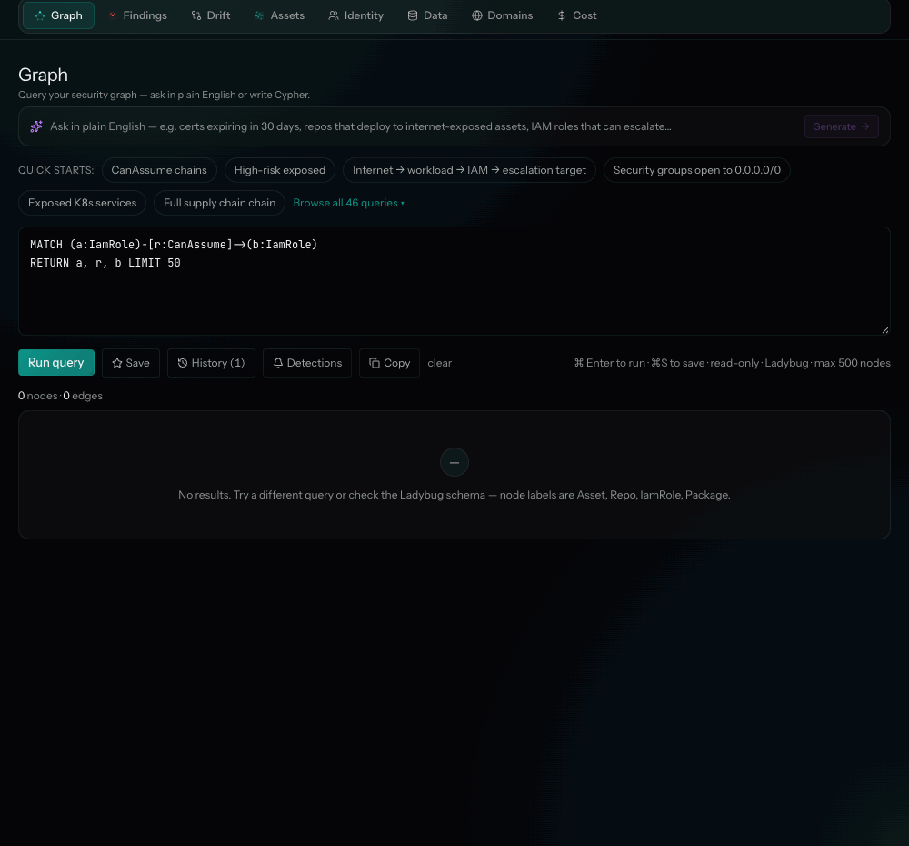

<div align="center">

<picture>
  <source media="(prefers-color-scheme: dark)" srcset="docs/images/logo-dark.svg">
  
</picture>

**A graph of your cloud, for seeing what an attacker could reach.**

[](https://scorecard.dev/viewer/?uri=github.com/vulngraph/vulngraph)
[](LICENSE)

[Documentation](docs/README.md) · [Getting started](docs/getting-started.md) · [Examples](docs/examples.md) · [Evaluating it](docs/evaluating.md) · [FAQ](docs/faq.md) · [Security policy](SECURITY.md)

</div>

Vulngraph is a self-hosted security graph for cloud accounts. It joins your cloud inventory, identities,
container images, packages and repositories into one graph, then ranks every risk by what an attacker
can actually reach. People use the UI. Your own security agents use the same graph over MCP with scoped
API keys: they query it and investigate a finding. Anything that would change your cloud needs a person:
proposed fixes wait in an approval queue (the UI, an email link or a signed webhook), and an agent's own
request runs only with a grant from a human admin. It runs in your environment.



- **Risk ranked by reach.** Each finding is scored by exposure, exploitability and blast radius, so the
  "must fix" list stays short and shows its evidence on every row.
- **One graph across tools.** Which internet-exposed workload can reach an administrator role? Where is
  this vulnerable package running, and which repository ships it? Ask in Cypher, in plain English, or over MCP.
- **Unknown is not clean.** Data it could not read is shown as unknown, never as passing.
- **Works with agents.** An MCP endpoint and read-scoped keys let an agent fleet ask questions and pull
  context for a finding without any access to your cloud. When the graph is unsure, an admin can have
  it verified live, read-only and audited. A key can never approve its own change: a real action needs a
  grant from a different human admin.
- **Read-only by default.** Collectors only read, nothing changes your cloud without a person's approval, credentials are isolated and actions are audited.
- **Yours to run.** One Go binary with Postgres and ClickHouse. Every outbound connection is documented.

Connects to AWS, GCP, Azure, Kubernetes, GitHub, Okta and Google Workspace.
[See it in action](docs/examples.md).

## Quickstart

You need Docker with Compose v2.24 or newer and about 6 GB of memory.

```sh
git clone https://github.com/vulngraph/vulngraph
cd vulngraph/deploy/docker-compose
docker compose up -d
docker compose exec serve /graph user create --email you@example.com --role admin
```

Open http://localhost:8080, sign in with the password it prints, and add the bundled **demo** connector to
explore a fictional AWS account in a few minutes. The [getting started guide](docs/getting-started.md) has
every step, and covers your own cloud, an LLM and production. To check one account from the command line
with no database, see [quick scan](docs/quick-scan.md).

## What it covers

| | |
|---|---|
| **Sources** | AWS, GCP, Azure, GitHub and Kubernetes, plus Okta and Google Workspace identity. |
| **Posture and identity** | About 850 checks across AWS, GCP, Azure and Kubernetes, mapped to the CIS Benchmarks for each ([coverage](docs/cspm-coverage.md)), and 66 privilege-escalation techniques across AWS, GCP and Azure. |
| **Vulnerabilities** | Package CVEs from VM inventories, SBOMs and container images, matched against OSV, CISA KEV and EPSS, plus Nuclei scanning of internet-facing assets. |
| **Prioritisation** | A 0-100 score from blast radius, exploitability and graph context, with a "safe to fix" class and an evidence-backed "must fix" class. |
| **Operations** | Scheduled Cypher detections, Slack and webhook alerts, an MCP endpoint, and an audit trail. |
| **Freshness** | Re-sync every 2 hours by default, GitHub changes immediately, any event through one API call ([how](docs/getting-started.md#5-keep-the-data-fresh)). |

Each, with its limits, is in [`docs/capabilities.md`](docs/capabilities.md).

## What it is not

- **Not an agent on your hosts.** It reads cloud APIs. It does not watch syscalls or protect a running
  workload, and it reads VM disks only where you opt in.
- **Not a SIEM or an event pipeline.** It tracks inventory, configuration and exposure.
- **Not an auto-remediator.** It proposes fixes. A person approves every state-changing action.
- **Not a replacement for your other controls.** Treat a clean result as clean within what it reads
  ([known limitations](docs/known-limitations.md)).

## Security

Vulngraph holds read access to your cloud, so it is built to be a safe thing to run.

- **Read-only by default.** Collectors use the read-only grants in [`docs/iam/`](docs/iam). Live cloud
  reads and any state-changing action are admin-gated, and only a person's approval runs a fix.
- **Credential isolation.** Connector secrets are encrypted at rest, and Nuclei runs in its own pod with no
  encryption key, LLM key or cloud identity ([details](docs/security-hardening.md#credential-isolation)).
- **Transparent egress.** Every outbound connection is listed in
  [Network egress](docs/configuration.md#network-egress). By default the worker sends **the ecosystem,
  name and version of each inventoried package to `api.osv.dev`** and **each monitored domain to
  `crt.sh`**. No usage telemetry is sent.
- **A written threat model.** [`docs/threat-model.md`](docs/threat-model.md) sets out what it defends,
  the trust boundaries, and which controls are weak or off by default.
- **A supply chain you can check.** Pinned dependencies and actions, CodeQL, gitleaks, govulncheck and a
  public OpenSSF Scorecard on every change, and signed release images with provenance and an SBOM
  ([verify one](deploy/README.md#verifying-a-release-image)).
- **Report privately** through [GitHub security advisories](https://github.com/vulngraph/vulngraph/security/advisories/new)
  or [`SECURITY.md`](SECURITY.md). Weighing it up? [Evaluating Vulngraph](docs/evaluating.md) has a
  five-minute audit.

## Project status

Early and pre-1.0: APIs, the graph schema and config keys may change ([`CHANGELOG.md`](CHANGELOG.md)).
It was used internally, including in production, for a while before being open sourced, so this is its first
public release and the first time outside users run it. It has one maintainer, is built with AI coding
assistance, and has not been security tested by anyone independent: no penetration test or third-party review.
The quality of the LLM's proposals is measured only by two small golden sets (10 and 8 cases),
run by hand ([details](docs/capabilities.md#reasoning-and-governance)). Support is best effort
([`SUPPORT.md`](SUPPORT.md)). Known limitations that affect results are in
[`docs/known-limitations.md`](docs/known-limitations.md).

## Community and contributing

Contributions are welcome. [`CONTRIBUTING.md`](CONTRIBUTING.md) covers building from source, the tests and
the project's conventions. See also [`ROADMAP.md`](ROADMAP.md), [`GOVERNANCE.md`](GOVERNANCE.md), [`SUPPORT.md`](SUPPORT.md) and the
[code of conduct](CODE_OF_CONDUCT.md). Questions and ideas go to
[GitHub Discussions](https://github.com/vulngraph/vulngraph/discussions), and bugs to
[issues](https://github.com/vulngraph/vulngraph/issues). The architecture is in
[`docs/architecture.md`](docs/architecture.md).

## Acknowledgements

Vulngraph builds on ideas from projects whose maintainers did the hard work first:
[Cartography](https://github.com/cartography-cncf/cartography) for the inventory graph,
[Prowler](https://github.com/prowler-cloud/prowler) and
[ScoutSuite](https://github.com/nccgroup/ScoutSuite) for open source cloud posture checks (Prowler's
compliance mappings are one of the sources behind ours, see [NOTICE](NOTICE)), and
[Steampipe](https://github.com/turbot/steampipe) and [CloudQuery](https://github.com/cloudquery/cloudquery)
for querying cloud APIs as SQL. Vulngraph's code is its own; the inspiration is theirs.

## License and trademarks

Apache License 2.0 ([`LICENSE`](LICENSE)). Vulngraph is an independent project, not affiliated with or
endorsed by any vendor named here. AWS, Google Cloud, Azure, GitHub, Kubernetes, Okta, CIS
Benchmarks and other names are trademarks of their owners, used only to describe
integrations. Check IDs prefixed `CIS-` are Vulngraph's own labels, not official CIS
recommendation numbers. See [`NOTICE`](NOTICE).
