# Examples

Every image on this page is Vulngraph running against the bundled demo account, Acme. Its data
is fictional. Load it yourself with the **demo** connector ([`demo.md`](demo.md)). Where a step uses an
LLM, the page says so, and the domain-monitor verdicts are fixed sample text.

## Walkthrough: from the "must fix" list to a fix

1. **Start at Home.** Four findings need a fix now, the highest risk band. Open **Findings → Must fix**.

   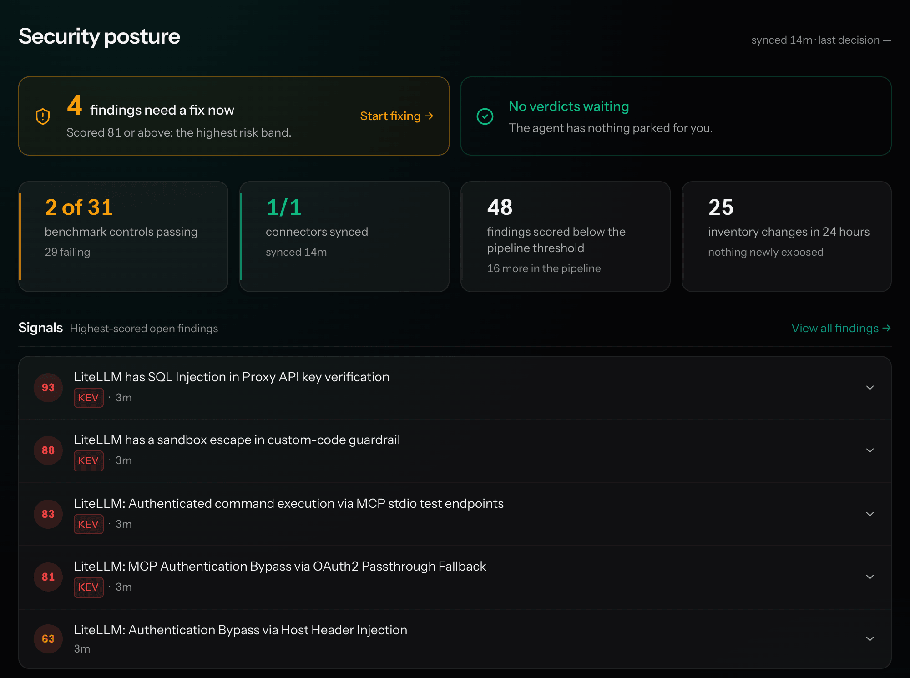

2. **Read the evidence on the row.** One finding is on the list: the `iam:PassRole` and `ec2:RunInstances`
   escalation on the `acme-web` role. The row says why it is there: reachable from an internet-exposed
   asset, one hop, an active escalation path, blast radius 6.

   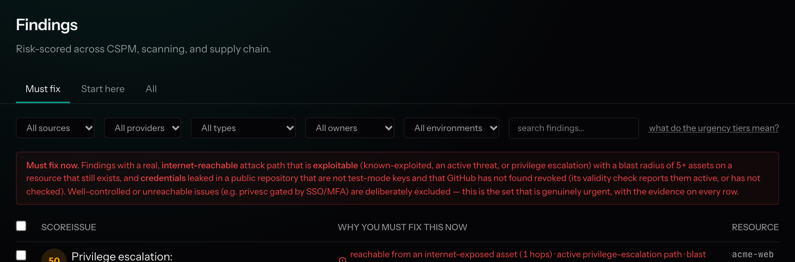

3. **Open it.** The finding page shows the severity reasoning, the graph facts it is grounded in, a plain
   risk story, and the score broken into attack paths, blast radius, identity hygiene and internet reach.
   **Verify live** asks the cloud directly whether it is still true before anyone acts.

   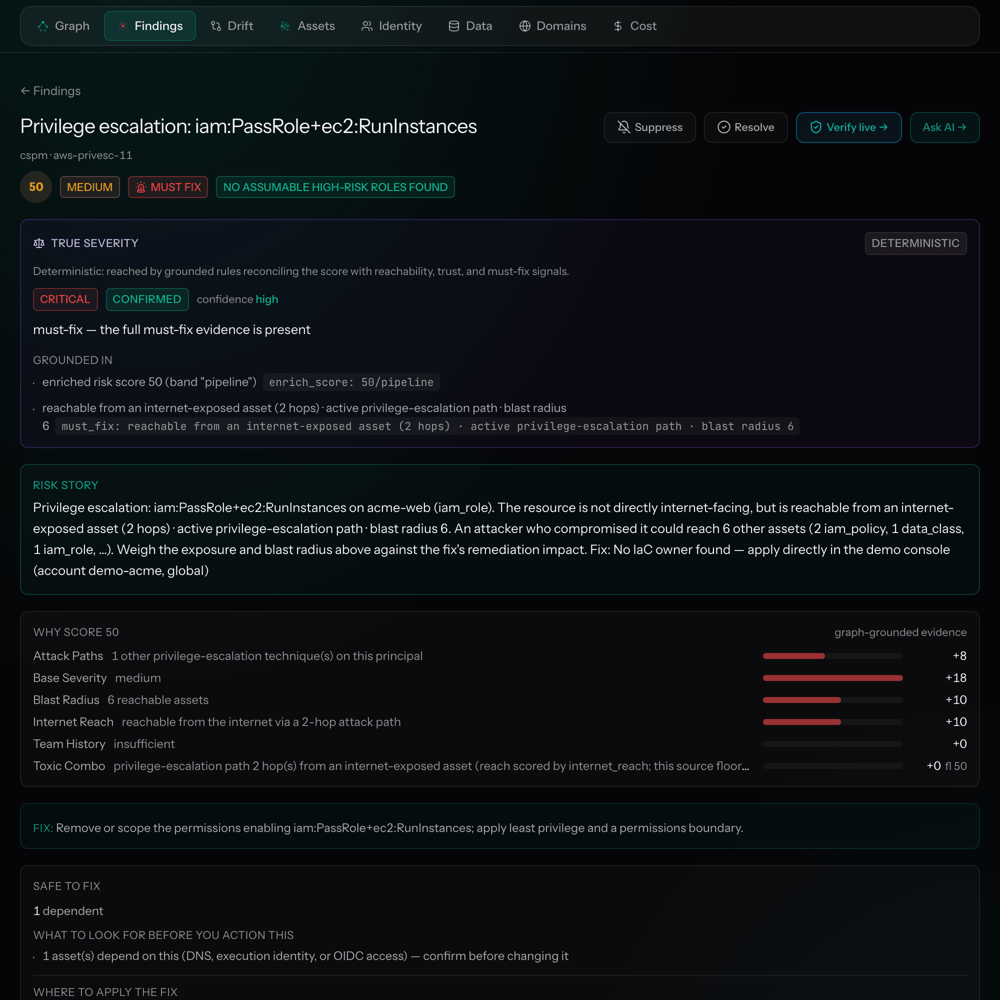

4. **See what it touches.** From the web server, the blast radius reaches the admin role, its policies and a
   secret.

   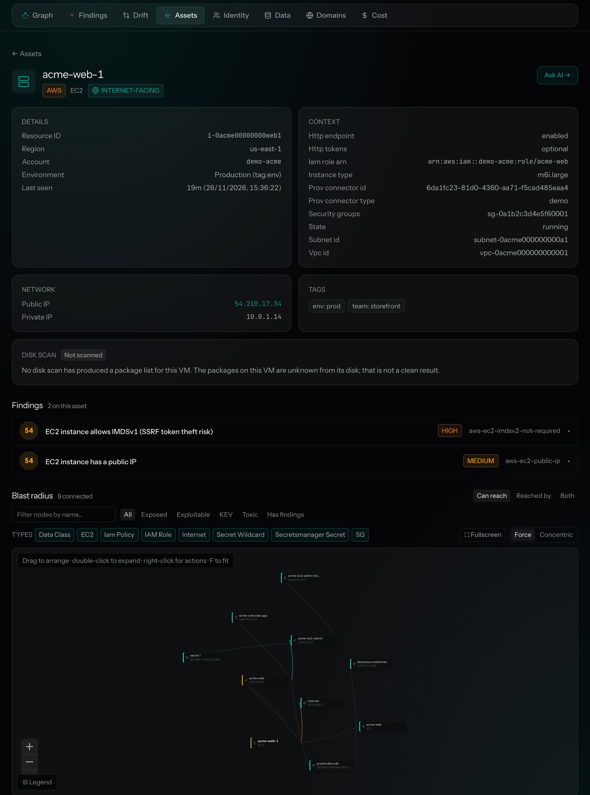

5. **Fix it.** The fix is to scope the permission; Vulngraph proposes it and a person applies it.

## Walkthrough: from a vulnerable package to the repository to fix

1. **See it ranked.** Both Acme services run LiteLLM 1.83.0, which matches 16 advisories, four of them on
   the CISA known-exploited list. Each advisory names its fixed version.

   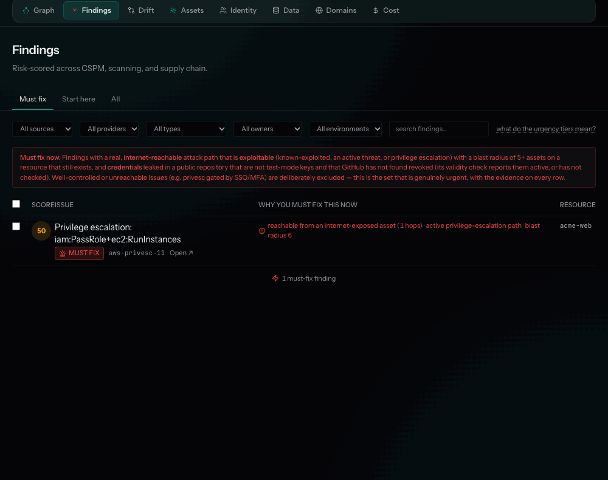

2. **Find where it runs.** One query returns every workload, image and package.

   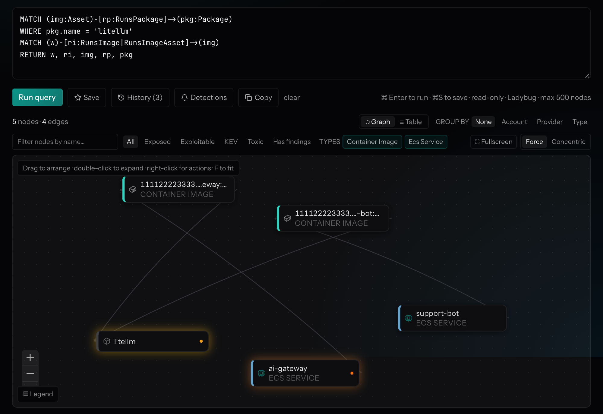

3. **Find who owns the fix, and whether it is exposed.** Only `ai-gateway` is reachable from the internet,
   and it was deployed from `acme-corp/ai-gateway`. `support-bot` runs the same library with no path from the
   internet, so it can wait.

   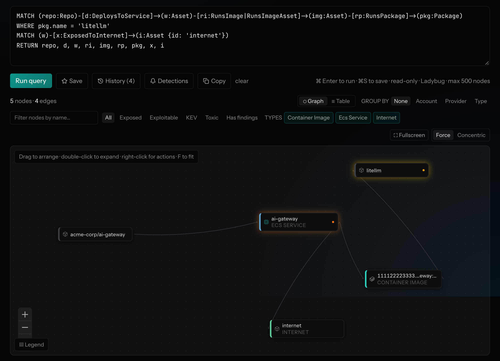

4. **Fix it in that repository,** upgrade to a release that names the fix, then re-sync. The finding
   resolves when the package is gone from the next sync.

## More queries

[`queries.md`](queries.md) lists all 38 Cypher queries from the Graph page, grouped by what they answer.

## Check the graph first, then verify live

Reading the graph needs no access to your cloud. The collectors hold the read credentials, so a person on
a viewer role or an agent with a read-scoped key asks questions of the stored graph and never touches an
account. When an answer is unclear, for example because the data is a few hours old or the graph names a
gap such as a network ACL it does not model, an admin (or an admin-scoped key) can ask the cloud directly.
**Verify live** on a finding does it from the UI, and the MCP tools `live_aws_describe` and
`get_cloudtrail_events` do it for an agent. Live calls assume the connector's read-only role through STS,
are admin-only by default (`LIVE_CLOUD_TOOLS_ROLE`) and write an audit row before they run.

An illustrative exchange (the demo account has no live cloud behind it, so this one is not a recording):

> **You:** Is acme-web-1 still reachable from the internet?
>
> **Agent** (calls `run_cypher`, read-only, no cloud access needed):
> ```cypher
> MATCH (a:Asset {name: 'acme-web-1'})-[x:ExposedToInternet]->(:Asset {id: 'internet'}) RETURN a, x
> ```
> One edge, last confirmed at the previous sync. A network ACL on its subnet is not modelled, so I would
> like to check the live security group before saying it is still open.
>
> **Agent** (calls `live_aws_describe` with `action: describe_security_group`, `resource: sg-0a1b2c3d4e5f60001`,
> audited, admin only): the rule allowing `0.0.0.0/0` on port 22 is still there.

The graph can be read by anyone with access. A live call costs an audited cloud API call and needs an admin,
so use it when the graph says it is not sure.

## Ask the graph

Everything is a node or an edge, so a question that spans tools is one query. The Graph page ships 46
ready-made queries and takes plain English when an LLM key is configured. Any MCP client can run the
same queries through `/api/mcp` and the read-only `run_cypher` tool.

> **You:** Show me all external assets deployed in us-east-1 in AWS
>
> **Agent** (calls `run_cypher`):
> ```cypher
> MATCH (a:Asset)-[x:ExposedToInternet]->(i:Asset {id: 'internet'})
> WHERE a.region = 'us-east-1' AND a.provider = 'aws'
> RETURN a, x, i
> ```

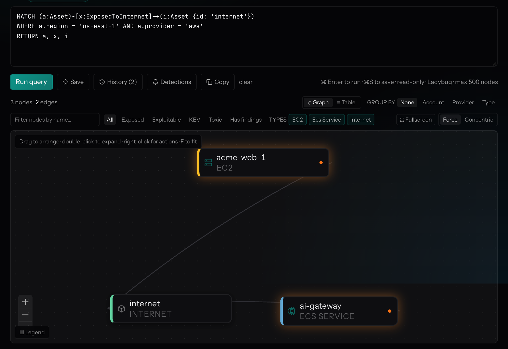

The plain-English box produces the same shape of query from the same question. The model writes the
Cypher, the graph answers.

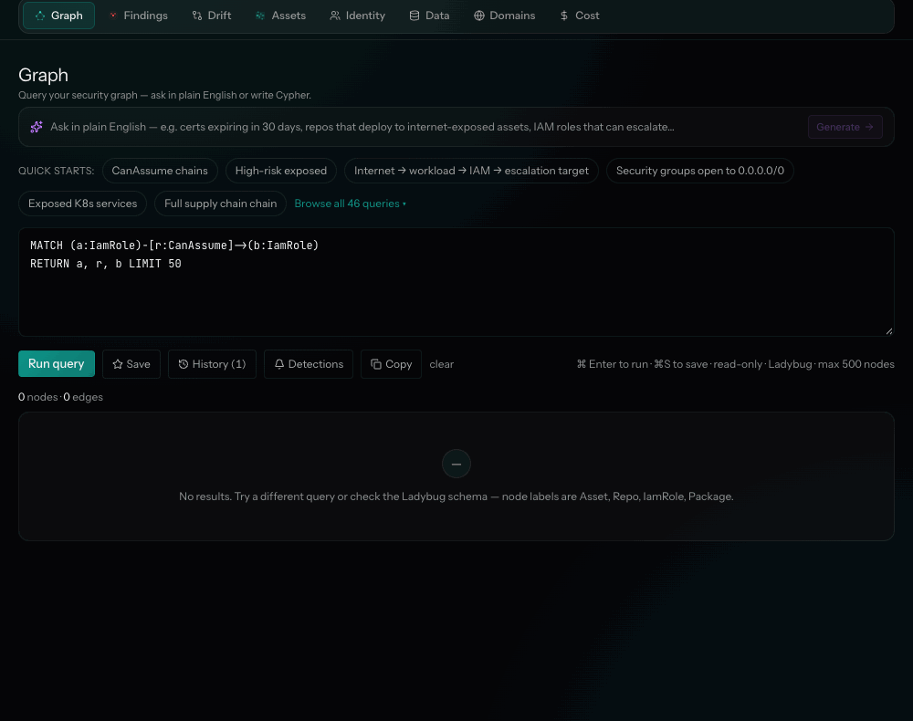

## Where is this package running?

```cypher
MATCH (img:Asset)-[rp:RunsPackage]->(pkg:Package)
WHERE pkg.name = 'litellm'
MATCH (w)-[ri:RunsImage|RunsImageAsset]->(img)
RETURN w, ri, img, rp, pkg
ORDER BY w.score DESC
```


The same LiteLLM release (1.83.0, affected by CVE-2026-40217, which CISA lists as exploited) runs on two
services. Only `ai-gateway`, marked with the red dot, faces the internet.

## Which repository is it coming from, and is it exposed?

```cypher
MATCH (repo:Repo)-[d:DeploysToService]->(w:Asset)-[ri:RunsImage|RunsImageAsset]->(img:Asset)-[rp:RunsPackage]->(pkg:Package)
WHERE pkg.name = 'litellm'
MATCH (w)-[x:ExposedToInternet]->(i:Asset {id: 'internet'})
RETURN repo, d, w, ri, img, rp, pkg, x, i
```


The fix goes to `acme-corp/ai-gateway`. `support-bot` runs the same library but has no path from the
internet, so it does not appear.

## Why a finding scores what it does

"Must fix" holds only findings with an exploitable path from the internet and real blast radius.


Open a finding to see its evidence: the severity reasoning, the graph facts it is grounded in, a plain
risk story, and a score broken into attack paths, blast radius, identity hygiene and internet reach.
**Verify live** asks the cloud directly whether it is still true.


## Blast radius of one asset


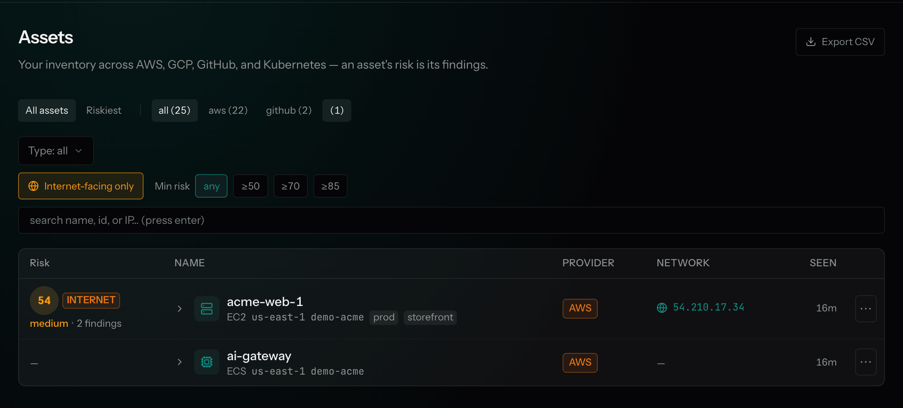

## What changed

Every sync records new assets, changed fields and new exposures, so "what changed since the last
sweep" has a direct answer.

The Home page leads with it: what needs a fix now, the highest-scored open findings, and the recent
inventory and exposure changes with the findings attached to each.

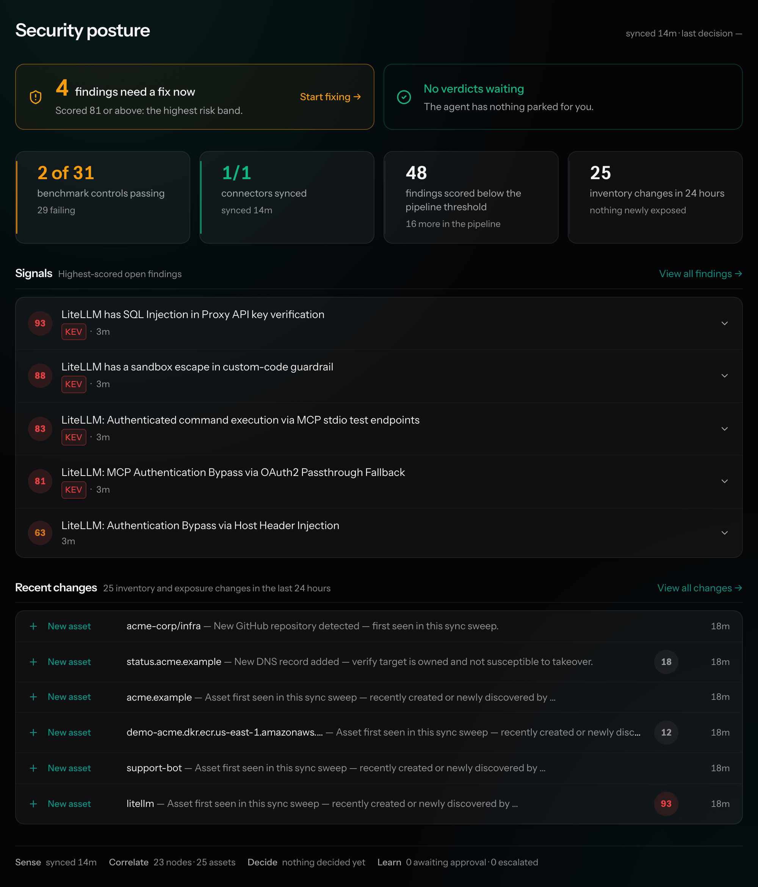

The Drift page lists every change with its findings.

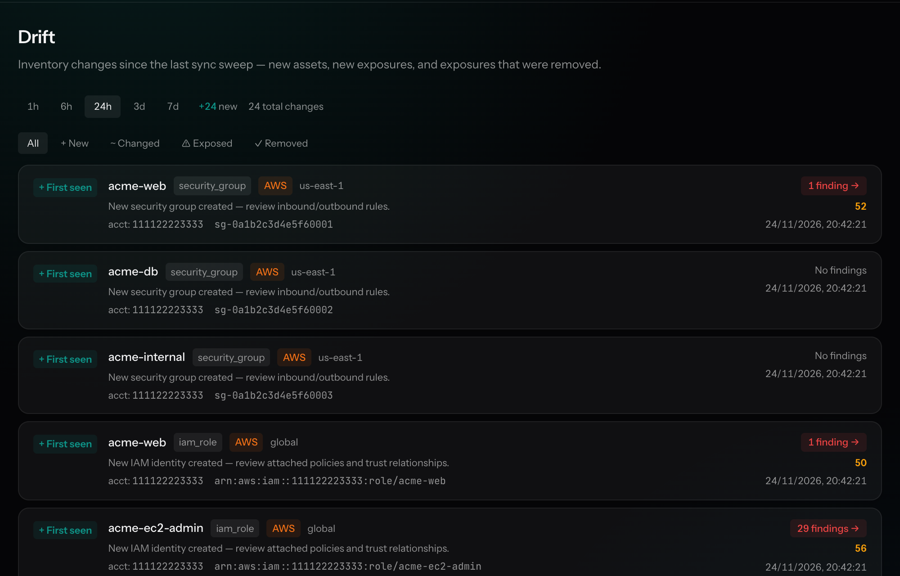

With an LLM configured, the chat panel answers the same question in words. It reads the same data through
read-only tools (`list_findings`, `list_connectors`, `run_cypher`, and `get_cloudtrail_events` for who made a
change). This recording asks "What changed in my environment since the last sync?". The model says there is no
sync-to-sync diff tool, infers the changes from first-seen times, and flags what it could not check.

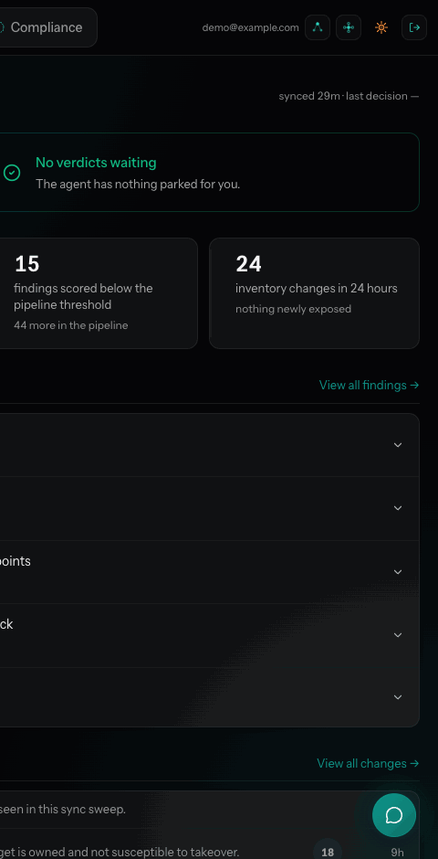

This answer was written by a model, so wording and details vary between runs and between models. Check a
claim against the finding or the graph before you act on it. The fixed versions in this recording are the
model's reading of the advisories. The finding pages show each advisory's own fixed version.

## What changed, and does it need investigation?

With `DRIFT_ANALYSIS_ENABLED`, the Drift page and the read-only MCP tools
`list_drift_analyses` and `get_drift_analysis` describe inventory changes and
cite the affected assets. Advice is LLM-derived. A failed or over-budget
analysis remains unknown; it never starts a scan or changes cloud resources.
Open the cited asset to inspect the evidence before acting.

## Identity

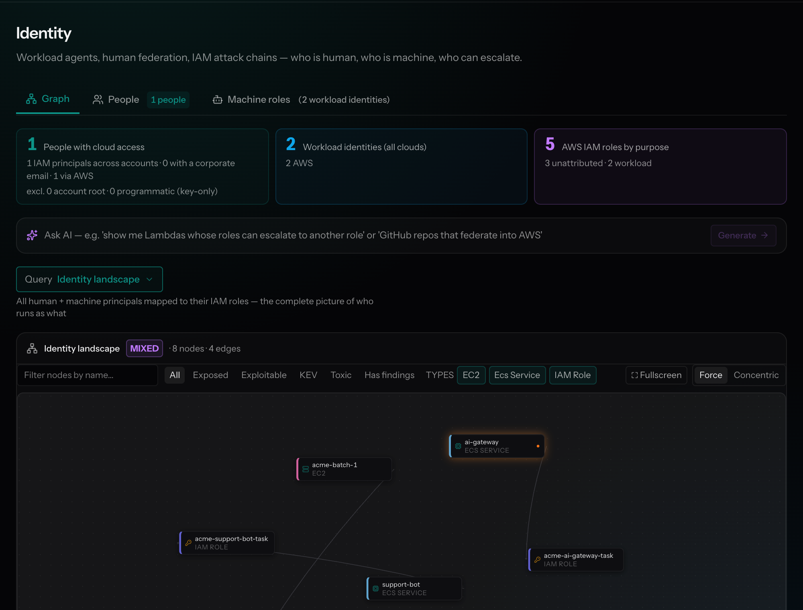

## Data stores, ranked by exposure

Classes are inferred from names and tags, and the page says so: nothing reads object contents, so an
inferred class is a lead to verify.

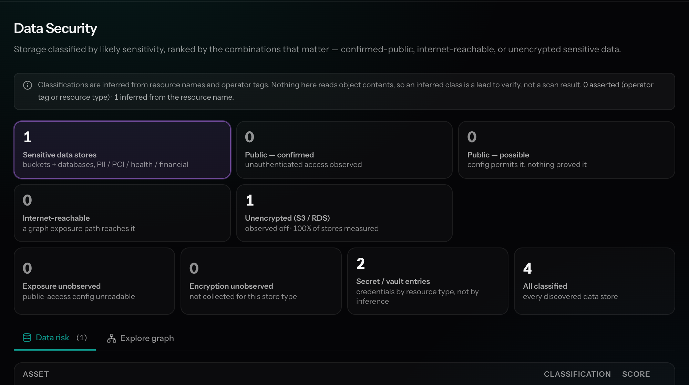

## Look-alike domains

Domain monitoring watches certificate-transparency logs for certificates that imitate a domain you own,
scores each by edit distance, homoglyphs and brand affixes, and has the configured LLM review it. The
verdicts below are fixed sample text, not model output.

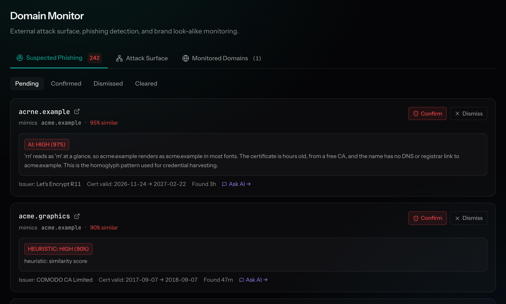

## Compliance and unknown controls

A control that cannot be assessed because the data is missing is shown as unknown, never as passing.

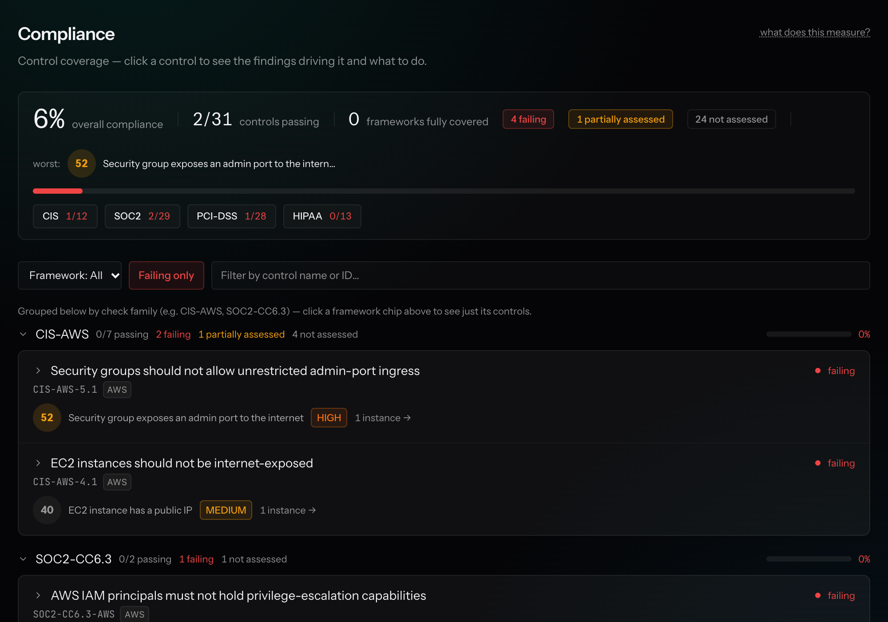

## Disk scan results

Illustrative, not a recording. With disk scanning on for a connector, an EC2 instance that has no SSM inventory
reports what its boot disk gave:

```jsonc
// GET /api/assets/i-0abc123def456/disk-scan
{
  "asset_id": "i-0abc123def456",
  "state": "scanned",
  "volumes": [{
    "volume_ref": "vol-0123456789abcdef0", "snapshot_source": "reused",
    "encrypted": false, "inventory_known": true, "cve_matchable_known": true,
    "package_count": 312, "observed_at": "2026-11-25T08:40:00Z"
  }]
}
```

An instance whose connector has not opted in, or whose disk could not be read, says so instead, and its
volumes carry a `gap` and no package count:

```jsonc
{ "asset_id": "i-0fedcba987654", "state": "none", "gap": "encrypted_no_key",
  "volumes": [{ "volume_ref": "vol-0aaaa", "encrypted": true, "inventory_known": false,
                "cve_matchable_known": false, "gap": "encrypted_no_key", "package_count": 0,
                "observed_at": "2026-11-25T08:41:00Z" }] }
```

`not_enabled` and `none` are unknown, never "no vulnerabilities". The asset page shows the same thing in a
Disk scan panel. Setup is in [capabilities](capabilities.md#vm-disk-scanning).

## Bring your own scanner: submit a VM's packages

If your own agent scans the disk (so Vulngraph needs no snapshot permission), it submits the package list
with an `inventory`-scoped API key an admin created. Only the packages go in; Vulngraph matches the
vulnerabilities and decides whether to believe the list.

```sh
curl -sS -X PUT "$VULNGRAPH/api/assets/i-0abc123def456/package-inventory" \
  -H "Authorization: Bearer $INVENTORY_KEY" -H "Content-Type: application/json" \
  -d '{"os":{"id":"ubuntu","version_id":"22.04"},"observed_at":"2026-11-25T09:30:00Z",
       "scanner":{"name":"acme-agent","version":"1.4.2"},"complete":true,
       "packages":[{"name":"libssl3","version":"3.0.2-0ubuntu1.10","source_name":"openssl"}]}'
```

`"complete": false`, or a list older than 7 days, comes back with `inventory_known: false` and a `gap`: the VM
reads as unknown, not clean. The full field list, limits and the MCP tool are in
[bring your own agent](iam/byoa-inventory.md).
