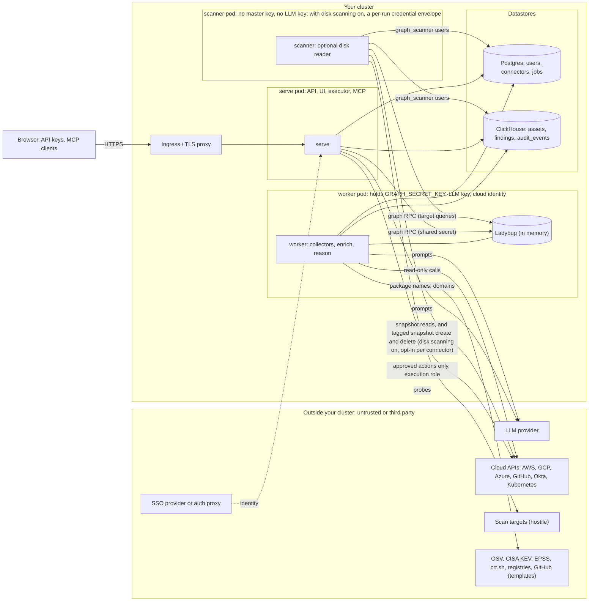

# Threat model

For a security engineer deciding whether to run Vulngraph with read access to a cloud estate. It says
what the project defends, where the boundaries are, and which controls are weak, optional or off by
default. Each claim points at a doc or at the code, and at the test that guards it where one exists. If
this page and the code disagree, the code wins. It is the project's own analysis: no third party has
reviewed it or the code ([evaluating](evaluating.md#what-to-know-before-relying-on-it)).

## 1. Scope and assumptions

- **Single tenant, self-hosted.** One organisation runs one install: one Go binary (`serve`, `worker`,
  `scanner`), Postgres, ClickHouse, and an in-memory graph engine (LadybugDB) inside the worker
  ([architecture](architecture.md)). There is no tenant isolation to attack, because there is only one
  tenant.
- **You run it.** You control the cluster, the datastores, the ingress and TLS. The chart's defaults
  are not all hardened; [security hardening](security-hardening.md) lists which and
  [`hardened.yaml`](../deploy/helm-values/hardened.yaml) turns the checkable ones on.
- **What it protects.** The credentials it holds to read (and optionally change) your cloud, the map of
  your estate it builds, and the rule that a person approves every state-changing action.
- **Pre-1.0.** One maintainer, used internally before open sourcing ([`SECURITY.md`](../SECURITY.md)).

## 2. Assets

| Asset | Where it lives | Why it matters |
|---|---|---|
| Cloud read credentials | Hub role and connector configs; the worker and serve hold the cloud identity | Read of your whole estate, including some secret-bearing responses (threat 11) |
| Connector secrets (GitHub key, Okta token, Google service-account key, Azure client secret, alert-channel secrets) | Postgres, sealed under `GRAPH_SECRET_KEY` | Whatever the stored credential can do, which is only as narrow as you granted ([iam](iam/identity-and-code-connectors.md)) |
| `GRAPH_SECRET_KEY` | Environment of serve and worker | Opens every sealed row, derives the second-admin grant key, and with the database mints sessions ([hardening](security-hardening.md#encryption-key)) |
| Execution roles | Your cloud, assumed only for approved actions | The only write path to your cloud |
| Findings, assets and the graph | ClickHouse, Ladybug (rebuilt from ClickHouse) | A ranked map of what is exposed and how to reach it. Reconnaissance value in itself |
| LLM context | Sent to the configured provider | Finding, asset and graph text, and live cloud results from chat ([llm-providers](llm-providers.md#data-egress)) |
| Disk-scan principal and per-run credential envelopes | The connector's config (sealed under `GRAPH_SECRET_KEY`), and, while a scan runs, a copy sealed under `DISK_SCAN_ENVELOPE_KEY` in the volume job's args | Snapshot read, and in `create_snapshots` mode create and delete, in your account (threats 17 and 18). Only exists when disk scanning is switched on |
| Audit log | ClickHouse `audit_events` | The evidence for who approved and ran what |
| Approvals | Grants (signed, 10 minutes, single use), queue verdicts, email links | They are what lets a change run |

## 3. Actors, trust levels and boundaries

| Actor | Trust | Notes |
|---|---|---|
| Admin | Trusted | Can change connector mode, opt a connector into disk scanning, change policy and users, and run approved fixes. Not defended against (section 5) |
| Analyst, viewer | Authenticated, limited | Roles are `admin`, `analyst`, `viewer` (`internal/app/auth/domain.go`). Every write route is role-gated or listed as exempt with a reason (`TestEveryWriteRouteIsGatedOrExempt`, `internal/httpsrv/routes_test.go`). Live cloud reads over MCP are admin-only by default (`TestLiveTools_AdminOnlyByDefault`) |
| API-key agents and MCP clients | Semi-trusted: may be driven by an LLM that reads hostile text | Scoped `read`/`write`/`admin` (and `inventory`, for a customer's own scanning agent: threat 16), capped at the owner's role. Barred from the routes that grant or widen access (threat 7) |
| LLM provider | Untrusted third party | Sees what the prompts contain. Its output is advisory (threat 5) |
| Cloud APIs | Trusted for availability, untrusted for content | Names, tags and descriptions in responses are attacker-chosen text |
| VM disk contents | Hostile | The opt-in disk reader parses them (threat 18) |
| Disk images of your VMs | Hostile content | With disk scanning on, the scanner pod parses partition tables, filesystems and package databases an attacker who owns the VM controls (threat 19) |
| Datastore hosts | Trusted | A compromised one is out of scope (section 5) |
| CI and release pipeline, upstream dependencies | Trusted to the extent you verify them | Threat 13 |



The boundaries that carry weight:

1. **Network edge to serve.** Authentication, role checks, CSRF and the executor rules live in serve.
2. **Pod boundaries.** The scanner holds the least. The worker and serve hold everything (threat 2). With
   disk scanning switched on, the scanner also holds the envelope key and the credentials of the volume
   job it runs (threat 18).
3. **Datastore users.** The scanner's users cannot reach users, API keys, connectors or the audit log
   (threat 8).
4. **Egress.** Only the list in [network egress](configuration.md#network-egress) is contacted, and the
   chart's NetworkPolicy does not restrict egress (threat 12).

## 4. Threats by boundary

Residual risk is stated as the control's own docs state it. "Chart" means the Helm chart in
`deploy/helm-chart/graph`.

### 4.1 Credentials and pods

| # | Threat | What the attacker gains | Mitigation | Residual risk |
|---|---|---|---|---|
| 1 | **Stolen or over-broad cloud credential** (hub role, stored key, token) | Read of the estate, plus whatever extra the stored credential allows | Connectors start `read_only` and the executor refuses every action on one before any cloud call (`internal/app/executor/service.go`, "Reject read-only connectors"). Read-only roles and the extras they need are documented per provider ([AWS](onboarding-aws-org.md#permissions), [others](iam/identity-and-code-connectors.md)). The hub role pins the pod's namespace and ServiceAccount ([hardening](security-hardening.md#credential-isolation)) | Vulngraph cannot narrow a stored credential: a GitHub App token carries every permission the App has, an Okta token its creator's role. AWS `SecurityAudit` and `ViewOnlyAccess` allow more reads than the collectors make ([docs README](README.md#reference)). Two optional extras widen reads to secrets (threat 11). Bundled AWS, GCP and Azure roles are only as tight as you apply them |
| 2 | **Compromised worker or serve pod** (bug in a collector, parser or dependency) | In serve or worker: `GRAPH_SECRET_KEY`, so every connector credential, the grant signing key and the ability to mint sessions. On AWS, `sts:AssumeRole` on the execution role directly, skipping every approval rule and writing no intent row. App database users that can insert an admin user or API key | Not prevented in application code: the approval rules are code in serve, not an IAM boundary ([hardening](security-hardening.md#credential-isolation)). Reduce it: the scanner is separate (threat 3); on EKS Pod Identity, `serviceAccount.serveName` plus `ExecutorServiceAccount` leaves the write path to serve alone; deploy execution roles only where you need them; alert on any `AssumeRole` of the execution role with no `executor.execute_intent` row before it. The app users are not server superusers (no `COPY ... TO PROGRAM`); the PostgreSQL role still owns its schema. The ClickHouse runtime user cannot rewrite `audit_events` | **This is the largest residual risk.** A compromised serve still holds the write path. The worker keeps read access, and the write path too unless you do the serve-only setup. GCP and Azure execution credentials cannot be limited this way. After a suspected compromise, rotate the key and every credential it sealed |
| 3 | **Retired external probing** | Historical Nuclei findings | Nuclei execution, template APIs and scan-profile jobs have been removed ([ADR 097](adr/097-retire-external-scanning.md)) | The opt-in disk reader remains a separate untrusted parser boundary; see threat 18 |

### 4.2 Network and request boundaries

| # | Threat | What the attacker gains | Mitigation | Residual risk |
|---|---|---|---|---|
| 4 | **SSRF** through connector URLs, webhooks or scan targets | Reach to internal services or cloud metadata | `safenet` is the only place outbound HTTP clients are built (`TestNoHTTPClientConstructedOutsideSafenet`, `pkg/safenet/client_literal_test.go`). Its guarded transport resolves the host and rejects private, loopback, link-local, metadata and tunnelled-IPv4 ranges at dial time, so DNS rebinding is covered (`pkg/safenet/http.go`). Scan targets are checked before the scan and again at dial. Link-local and cloud metadata addresses stay blocked even with `SCAN_ALLOW_INTERNAL_TARGETS=true` | Internal-trust clients (`NewInternal*`) apply no guard and are for operator-configured URLs only. The LLM client is one: `LLM_BASE_URL` is trusted configuration (`internal/llm/openai.go`). The package notes that third-party SDKs use their own transports unless given a safenet one. Do not set `SCAN_ALLOW_INTERNAL_TARGETS` unless you accept admins reaching in-cluster services |
| 5 | **Prompt injection** through finding, asset or tag text (anyone who can name a bucket, tag an instance or supply hostile inventory text chooses it) into the LLM, and from there toward remediation | A hostile instruction in model context; at worst a misleading proposal | Untrusted text is wrapped in markers and any attempt to forge the end marker is escaped (`pkg/promptfence`, `TestFence_*`). The code says plainly this is a delimiter, not a boundary, and that call sites are reviewed, not mechanically enforced. The boundary is what follows. Remediation is a closed catalogue of typed actions with validated parameters, and an unknown action is rejected (`specs` in `internal/app/executor/plan.go`). A cited AWS resource ID that is not in the model's context escalates the decision to a person (`internal/app/respond/grounding.go`). Vulngraph never remediates on its own: only read-only `observe` plans skip approval, and every state-changing action is proposed and runs only after a person approves (`TestAutoExecuteGateRequiresKnownEvidence` and `evidence_guard_test.go`, `TestGate_NoStateChangingInputIsAutonomous`, both in `internal/policy`; `TestOnlyHumanTransportsBuildExecutionRequests`, `internal/app/executor/no_autonomy_guard_test.go`). `TestExecute_RefusesWithoutAPrincipal` refuses a run with no authenticated person | A model can still be steered into a misleading rationale or a wrong proposal that a tired approver accepts. The quality of proposals is measured only by two small hand-run golden sets ([capabilities](capabilities.md#reasoning-and-governance)). Confidence learned from human verdicts changes how a proposal is raised, never whether a person is asked. An approval webhook receiver you wire up to act on approvals sits outside all these rules ([hardening](security-hardening.md#approval-webhook)) |
| 6 | **LLM-derived drift analysis read by another agent over MCP** (`get_drift_analysis`, `list_drift_analyses`, off by default) | Steer an agent that reads the verdict, or have a scan wrongly skipped or started, by naming an asset or tag with instructions in it | Asset names, tags, domains and old and new values are fenced in the prompt and the reply is bound to a JSON schema (`TestPromptFencesEveryAssetField`). A deterministic gate drops any evidence that does not cite an asset or profile that was in the prompt, clears a suggested profile or template tag that is not an enabled profile's own, and turns a "no scan needed" into unknown unless every input was known and the batch was not truncated. A failure or budget refusal is stored as unknown, never as "no scan needed". Results carry `advisory: true` and the MCP output is fenced like every tool result. Nothing in the analysis path can start a scan (`TestDriftAnalysis_NeverEnqueuesScanKinds`). `start_profile_scan` is admin-only, audited (`mcp.scan_start`), limited to 5 per user per minute, and does not read the verdict | A wrong or steered verdict can still mislead a person or an agent that acts on it without checking. Treat it as a hint and read the evidence. An admin or an agent holding an admin key can start any profile scan without a drift analysis. Drift-enabled profiles still scan on drift as before, whatever the analysis says |
| 7 | **Malicious or leaked API key or MCP client** | Whatever the key's scope and owner's role allow | Key is 32 random bytes, stored as a SHA-256 digest, shown once, expires within `API_KEY_MAX_LIFETIME_DAYS` (default 90) and stops working when its owner is disabled. A key cannot create keys or users, change connector mode or a connector's disk-scan mode, purge or delete a connector, change the approval policy or resolve the approval queue: those routes need a signed-in session and answer 403 to a key, audited as `auth.api_key_refused` ([hardening](security-hardening.md#api-keys)). A key cannot suppress or resolve critical, must-fix or unscored findings and its suppressions expire within 30 days. Every real execution on a key, over REST or MCP `execute_action`, needs a grant minted by a **different** admin from a session; a key can never mint one. A grant is bound to the exact plan, connector and action, expires in 10 minutes and works once (`ApprovalTTL` in `internal/app/executor/approval.go`; `TestApproval_*`, `TestExecutorREST_APIKeyNeedsADifferentAdminsGrant`, `TestExecuteAction_RequiresAGrantForEveryRealExecution`). The approving account must be at least 24 hours old by default | A key can read everything its role can, and key reads are not audited per call (`last_used_at` only). An admin cannot list or revoke another user's key, only disable the owner. Offboarding at the IdP does not end keys. The two-person rule compares user ids, so one person with two admin accounts defeats it. An admin key can still change alert channels, saved queries, scan profiles and intel settings. Hand agents read-scoped keys |

### 4.3 Data and integrity boundaries

| # | Threat | What the attacker gains | Mitigation | Residual risk |
|---|---|---|---|---|
| 8 | **Tampering with the audit log** | Hide who approved or ran a change | `audit_events` is plain MergeTree with a 7-year TTL, and no application path updates or deletes it. serve and worker connect as a ClickHouse user with `SELECT` and `INSERT` only on it; the scanner's user cannot touch it (`deploy/helm-chart/graph/files/clickhouse-users.xml`). An execution writes an intent row before the cloud call and is refused if it cannot ([hardening](security-hardening.md#connectors-and-remediation), `TestExecute_IntentWriteFailureRefusesExecution`) | Not tamper-proof. The migrate user and whoever runs the ClickHouse pod can rewrite it, as can any external ClickHouse user you grant more than the bundled grants. Admin-action rows are written after the change commits: if ClickHouse refuses the write, the change stands and only an `AUDIT WRITE FAILED` log line says so. Reads and many background actions are not recorded. Export rows to your SIEM or write-once storage if you need tamper-evidence |
| 9 | **Cypher injection or write Cypher** through the API, MCP, chat, saved queries or an LLM-generated query | Modify the graph, read server files, load code, exfiltrate | One read-only guard everywhere untrusted Cypher enters (`internal/graphquery/guard.go`: opening-clause allowlist plus keyword denylist, single statement only), backed by the engine's own read-only check on the prepared statement in graphstore. Tests include bypass and lexer-divergence cases (`backtick_bypass_test.go`, `lexer_divergence_test.go`). The graph is a disposable projection rebuilt from ClickHouse, so a corrupted one is not the record. Only `graphstore` writes it, only `explore` reads it | Caller Cypher shares a two-connection pool with scheduled detections: a per-user rate limit (`CYPHER_RATE_LIMIT_PER_USER`) bounds how often one user starts a query, but there is no queue or concurrency cap, so a few users sending slow queries can still starve detections for the engine timeout. The worker's graph RPC is protected by a shared secret that the chart derives from `GRAPH_SECRET_KEY` unless you set one, and `LADYBUG_RPC_INSECURE=true` removes it |
| 10 | **Degraded input that reads as clean** (a failed read, an unreadable route table, a partial sweep) | A real exposure or path shown as absent or safe, so a person approves the wrong thing or skips a fix | Missing data is unknown, never zero: unknown internet hops stay unknown ([architecture](architecture.md#3-decide-reason-in-context-a-person-approves)); policy evidence fields are paired with a `Known` flag whose zero value is the safe one, and the auto-execute gate requires known evidence (`TestAutoExecuteGateRequiresKnownEvidence`); an incomplete graph load is refused and the previous graph kept (`ErrRebuildRefused`, `graphstore/fidelity.go`); a sweep that did not list every page cannot mark resources gone ([evaluating](evaluating.md#missed-paths-and-false-negatives)). Graph readers must apply edge and asset freshness (`TestGraphEdgesReadersApplyFreshness`, `TestAssetReadersApplyLiveness`) | These are pinned for the paths that matter, not proved for every path. Known blind spots are written down: network ACLs and GCP firewall policies are not applied to exposure, EKS Pod Identity is not collected, lateral movement is partial ([known limitations](known-limitations.md)). Treat a clean result as clean within what it reads |
| 11 | **Secrets in what collectors read** | Plaintext secrets visible to the credential, and to anyone who steals it | The managed read-only policies return secret-bearing configuration (container and Lambda environment variables, EC2 user data, CloudFormation parameters, stage variables). [Onboarding](onboarding-aws-org.md#permissions) tabulates each call and what Vulngraph keeps: usually nothing, or only the names of secret-looking variables so it can flag them. Terraform state and ECR layer reads are optional and off unless you grant them. Vulngraph's state parser keeps only each resource's address, `arn` and `id`. Azure Key Vault reads return attributes, never secret values ([iam](iam/azure-permissions.md)) | The protection is that Vulngraph keeps little, not that the credential cannot see it: anyone holding the role or the worker's credentials reads it at the source. Leave the Terraform state and ECR grants off unless you need them. The LLM sees finding and asset text, so check it carries nothing you would not send out |

### 4.4 Egress, supply chain and sign-in

| # | Threat | What the attacker gains | Mitigation | Residual risk |
|---|---|---|---|---|
| 12 | **Data egress** | Your package inventory, monitored domains, finding context, alert text | Every destination, what it sends and its switch are in [network egress](configuration.md#network-egress). By default the worker sends the ecosystem, name and version of each inventoried package to `api.osv.dev` and each monitored domain to `crt.sh`. `OFFLINE_MODE=true` turns off every one of them that has a switch (the feeds, OSV, crt.sh, image pulls and the AWS cost pull). The UI loads nothing third-party. No usage telemetry is sent | The chart's NetworkPolicy restricts **ingress only**, so egress is open until you add your own policy. The takeover check's DNS lookups have no switch. Configured integrations (LLM, Slack, webhooks, SMTP, connectors) are not touched by `OFFLINE_MODE`: remove the integration. A hosted LLM sees finding, asset and graph context and, from chat, live cloud results; use a local model server if that matters ([llm-providers](llm-providers.md#data-egress)) |
| 13 | **Supply chain of Vulngraph itself** | Code execution in every pod, so threat 2 | Every workflow action is pinned by commit SHA and workflows default to read-only `contents` (`.github/workflows`). Base images in the Dockerfile are pinned by digest and the runtime user is nonroot. CI runs lint, tests, gitleaks, CodeQL and govulncheck on the built binary, which fails on any vulnerable symbol linked in unless listed in `.github/govulncheck-allow.txt` (any exception must carry a reason). Scorecard runs weekly and publishes results. Dependabot opens one grouped monthly pull request per ecosystem. The release workflow builds with SLSA provenance and an SBOM, then keyless-signs the image and attests it by digest ([verify a release image](../deploy/README.md#verifying-a-release-image)). The chart can require an image digest (`hardened.yaml`) | Signing and attestation run only while the repository is public (`release.yaml`). The remaining dependencies still require review; removing the external scanner reduces that surface but is not proof of safety. This repository's history starts at the first public release. You still decide what you trust: verify the signature and pin the digest |
| 14 | **SSO and session weaknesses** | Account takeover, an admin session | Sign-in methods are local password, Google, Okta, IAP and oauth2-proxy. Allowlists are mandatory: with none, every sign-in through that provider is refused. Google also requires the `hd` claim. oauth2-proxy and IAP assertions are verified for signature, issuer, audience and expiry, and an account is bound to (issuer, subject). A new SSO user is a viewer unless named admin. Cookies are `HttpOnly`, `SameSite=Lax` and `Secure`, never downgraded from request headers (`internal/app/auth/handler.go`). Login is rate-limited per address and per account. `BYPASS_AUTH` needs a second acknowledgement variable and a Host allowlist, and cloud changes are refused under it (`TestExecute_RefusesUnderBypassAuth`) | Admin TOTP is optional unless `REQUIRE_ADMIN_TOTP=true`, and it covers password sign-in only. Sessions last 7 days with no idle timeout and there is no SCIM: removing someone at the IdP does not end their session in direct Google or Okta mode, or their API keys. Disable the user in Vulngraph. A bootstrap race is closed by an advisory lock, but set `ADMIN_EMAILS` on any install reachable before you sign in. `graph user token` mints a full session for whoever has the database and key. Each dangerous flag is [listed](security-hardening.md#dangerous-flags) and the hardened chart refuses to render with one set |
| 15 | **CSRF and cross-site requests** | Act as a signed-in admin from a hostile page | State-changing `/api` requests must be same-origin (`Sec-Fetch-Site` or `Origin` check) and must send `application/json`, which a cross-site form cannot. Login is covered. Only the signed GitHub webhook and the emailed-link endpoints are exempt, because they carry their own credential (`withCSRF` in `internal/httpsrv/security.go`; `TestCSRF`). Security headers include CSP, `X-Frame-Options: DENY` and `Referrer-Policy: no-referrer` (`TestSecurityHeaders`). A JWT-shaped bearer, which a proxy may inject into every request, never relaxes the checks | Approval email links are bearer credentials: whoever holds the URL can act, and forwarding the mail forwards it. They are single use, expire in 48 hours, cannot approve `isolate` or `destroy`, and a GET only renders a page. They record a verdict and run nothing in Vulngraph, but a mail gateway that submits forms would confirm it ([hardening](security-hardening.md#email-approval-links)) |
| 16 | **Semi-trusted agent submits false package inventory** (bring-your-own-agent, `PUT /api/assets/{id}/package-inventory`, MCP `submit_package_inventory`) | The package list of one named VM: a false but fresh, complete list hides that VM's vulnerable packages, or a long false list adds noise | A dedicated `inventory` key scope that only an admin can create and that reaches nothing but the two routes and the one MCP tool, and stops with its owner's admin role (`TestRequireAuth_InventoryKeyIsConfinedToInventoryRoutes`, `TestAPIKeyCreate_InventoryScopeIsAdminOnly`, `TestPackageInventory_NonAdmin_403`, `TestPackageInventory_WrongScope_403`, `TestSubmitPackageInventory_WrongScope_Refused`). Known-ness is the server's: `complete` defaults to false, and a list is believed only when it is complete, under 7 days old and its OS resolves to an enabled advisory source; anything else is a gap and writes no edges (`TestByoaCannotMarkClean`). Only `runs_package` edges from the one named, live VM are written, and an asset that does not exist, is not a VM, or was deleted or forgotten is refused (`TestByoaCannotWriteOutsideNamedAsset`, `TestByoaCannotResurrectDeletedAsset`). One stored inventory per (key, scanner, asset), so another key cannot replace it, a newer one replaces an older and an older is refused. Unknown fields are refused, so a body cannot carry findings. Strings are pattern-limited and stored without newlines (`TestStoredProvenanceHasNoNewline`). Body, package and rate caps. Every submission, accepted or rejected, is audited as `inventory.submit` ([byoa-inventory](iam/byoa-inventory.md)) | A lying `complete: true` inventory is believed until it goes stale, up to 7 days, or until the next submission replaces it. Vulngraph cannot check a list against the machine. The impact stops at the named VM's package list, but a hidden vulnerable package is a hidden finding on that VM. Package names and versions are free text within a character set and reach package assets shared by every VM running the same package. Edges from a revoked key's last submission lapse only after the 48-hour edge freshness window, although revoking the key deletes its inventory records at once. Use one key per agent and a short expiry |
| 17 | **Snapshot creation in your account** (disk scanning, `create_snapshots` mode; off by default) | A principal in your account that can create and delete snapshots, and both disk-scan modes can read every snapshot the role can see: snapshots are whole disks, secrets included | Disk scanning is opt-in per connector and the mode stays off until an admin signed in as a person types the confirmation sentence naming the cost and the permission; a key, MCP or a non-admin is refused and every change is audited as `connector.disk_scan_change` with before, after, role and actor (`TestSetDiskScanMode_Refusals`, `TestDiskScan_NonAdmin_403`, `TestDiskScan_APIKeyAdmin_403`, `TestHighImpactWritesRequireSession`). Writes use a separate principal that must differ from the collection, read-only and execute roles (`disk_scan_role_arn`, `disk_scan_client_id`, `disk_scan_service_account`). On AWS its role grants only `ec2:CreateSnapshot` when the request tags the snapshot `vulngraph-disk-scan`, `ec2:CreateTags` at creation, and `ec2:DeleteSnapshot` on snapshots that carry the tag (`TestDiskScanRoleIsTheSnapshotActionList`, `TestHubDiskScanRoleIsOptIn`); the snapshot read grant is a template parameter that defaults to `false` (`TestDiskScanReadIsOptIn`). In code only the `snapshotter` package may hold a mutating client, and only with an `OptIn` that `Authorize` returns when the mode, the role and its distinctness all hold; jobs import no cloud mutator (`TestSnapshotMutationAllowlist`, `TestMutatingClientsOnlyInSnapshotter`, `TestAuthorize`, `TestJobsNeverImportCloudMutators`, `TestVolume_NoWriteCallWithoutAnOptIn`). Delete re-reads the live tag and refuses an untagged snapshot (`TestDeleteOnlyTaggedSnapshots`). An intent row is written before every create, so a crash leaves a record, and a sweeper deletes any tagged snapshot past its time to live (6 hours by default) even if the database record is lost (`TestSweep_DeletesOnlyExpiredTaggedSnapshots`). Concurrent snapshots and a daily snapshot cap bound cost. Nothing here is an executor action, and the ADR 087 gate tests are unchanged | The opt-in is a standing approval, not a per-snapshot one: no person approves each snapshot. This is the one place Vulngraph writes to your cloud without a per-action approval, limited to short-lived tagged snapshots. Cost caps are code, not IAM. Whoever holds the disk-scan role (a compromised worker or scanner, threat 2 or 18) can create tagged snapshots up to your account's limits and delete tagged ones, and can read any snapshot the read grant covers. On Azure the read path needs a short-lived read SAS on the snapshot even in `existing_snapshots` mode: it is authorized by a separate read opt-in that covers the grant and revoke pair and never create or delete, needs the dedicated principal in both modes, and is revoked on every exit path (`TestAuthorizeRead`, `TestAzure_ReadRequiresValidReadOptIn`, `TestVolume_AzureExistingSnapshots_GrantIsRevokedOnEveryPath`). Customer-managed encryption keys stay yours: without `kms:Decrypt` the volume is `encrypted_no_key`, unknown, not clean ([AWS](iam/disk-scan-aws.md), [Azure](iam/disk-scan-azure.md)) |
| 18 | **The scanner pod holds disk-scan credentials and parses untrusted disks** (disk scanning on; off by default) | Code execution in the scanner pod through a disk parser, then the envelope key, the credentials sealed into the volume jobs in flight and, on Azure, the disk-scan client secret | The scanner needs two switches before it holds anything: `DISK_SCAN_ENABLED` and `DISK_SCAN_ENVELOPE_KEY` on the worker and the scanner. The key is not derived on the pod from `GRAPH_SECRET_KEY` and opens nothing but envelopes. The worker, which can decrypt connectors, seals one envelope per run and connector, bound to the run and connector and expiring with the run (`TestSealOpenRoundTrip`, `TestOpenRefusals`, `TestSealRequiresBinding`). **On AWS the scanner assumes no role and holds no long-lived key**: the envelope carries two STS sessions minted by the worker, one of the collection role cut to the snapshot read actions and, in `create_snapshots` mode only, one of the disk-scan role cut to `ec2:CreateSnapshot`, `ec2:CreateTags` and `ec2:DeleteSnapshot`, each lasting at most an hour, so the hub need not trust the scanner's ServiceAccount (`TestAWSSessionPoliciesAreExactlyTheSnapshotActions`, `TestOpenAWSUsesTheSealedSessionsAndAssumesNothing`, `TestOpenRefusesExpiredAndForeignEnvelopes`). A job that starts after its credentials expire, or is refused as expired, becomes the `stale` gap, never a retry loop (`TestVolume_ExpiredCredentialsAreAGapNeverARetryLoop`). The scanner has no grant on `connectors`; it reads the disk-scan mode through a view of id and mode and writes only the `disk_scan_*` tables (`TestScannerGrantsMatchWhatTheScannerRuns`). Reads are capped in bytes and the lane runs one volume at a time | With the switch on, "the scanner holds no credential" no longer holds. Residual blast radius, precisely: (1) the envelope key opens every envelope in the River job args, which the scanner's database user can read, so a compromised scanner can open the envelopes of runs that have not expired, for every disk-scan connector; (2) on AWS each envelope yields sessions that last at most an hour, usable only for the snapshot read actions in the connector's account, plus, in `create_snapshots` mode, creating tagged snapshots and deleting tagged ones, until they expire; (3) a connector with static `aws_access_key_id` keys and no `role_arn` has nothing to assume, so those long-lived keys are in its envelope; (4) **on Azure the envelope carries the disk-scan client secret itself, which does not expire** until you rotate it, so a compromised scanner keeps the principal's read (and in `create_snapshots` mode create and delete) rights past the run; (5) the collection session on AWS can read any snapshot the read grant covers, whole disks included. Keep `DISK_SCAN_ENABLED` off if you do not use disk scanning, give the disk-scan principal only the permissions on its page, and treat the scanner pod as holding that connector's disk access while a run is live (AWS) or until the secret is rotated (Azure) |
| 19 | **A hostile disk image attacks the partition, ext4 and XFS parsers** (anyone who controls a VM, or a snapshot you let Vulngraph read, controls these bytes) | Code execution or denial of service in the scanner pod, or a false inventory | The readers are Go code written for untrusted input (`internal/scanner/diskscan/{part,ext4,xfs}`): every length and block number is checked before use, loops are bounded by structure depth or image size, and a read has byte, file and total budgets (`TestScanDisk_HostileSizesStayBounded`, `TestTruncatedImageNeverPanics`, `FuzzPartition`, `FuzzExt4`, `FuzzXFS`, `FuzzScanDisk`). Only an allowlist of files is exposed (package databases, `os-release`), symlinks are resolved inside the image, and language manifests are never read (`TestLimitedFS_ExposesOnlyTheAllowlist`, `TestScanDisk_LanguageManifestsAreNeverRead`). A layout the readers do not handle (LVM, RAID, Windows, encrypted, unknown filesystem or feature) is a gap, never an empty list (`TestDegradedIsUnknown`). Parsed packages go through the same dpkg, apk and rpm parsers as container images | Go is memory-safe, so a parser bug more likely costs time or memory than code execution, but the fuzz tests are a floor, not proof. The disk belongs to the machine being scanned: a compromised VM can edit its own package database, so the list can hide or add packages (the same lie as threat 16), and package names and versions are free text that reach package assets shared by every VM running the same package. The journal is not replayed, so a snapshot taken mid-write can describe slightly older state ([known limitations](known-limitations.md)) |

## 5. Out of scope or not defended

- **A malicious admin.** An admin can switch a connector to `read_write`, create a second admin account they
  control and, once it passes the account-age floor, approve their own destructive actions. The floor counts from the
  later of the account's creation and the time its role last became admin (`users.admin_since`), so promoting an
  old account does not skip it, but waiting out the floor on a second admin account does. The two-person rule stops one account
  approving its own change, not one person holding two. [`SECURITY.md`](../SECURITY.md) puts
  admin-only abuses of the role out of scope, but treats any way for one admin, or a key, to skip a
  required grant, run an action with no person approving, or get past the account-age floor as in scope.
- **Code running in serve or the worker.** See threat 2. The approval rules are application logic.
- **A compromised Postgres or ClickHouse host, or its backups.** Whoever holds the database and
  `GRAPH_SECRET_KEY` holds the credentials and can forge sessions. There is no KMS or HSM integration,
  so unwrapping the key is not a separately authorised or audited call.
- **Plaintext on the pod network.** The bundled datastores are unencrypted until you give them
  certificates, and Compose connects in plaintext ([network policy](security-hardening.md#network-policy)).
- **Multi-tenancy.** It is not a multi-tenant service. Do not run one install for mutually distrusting teams.
- **Runtime protection.** No host agent and no syscall monitoring. It reads cloud APIs, and reads VM disks
  only where you opt in (threats 17 to 19; [README](../README.md#what-it-is-not)).
- **The LLM provider.** If you configure a hosted one it sees the context in its prompts. The only way
  to keep that in-house is a local model server or no LLM.
- **Network ACL and some firewall gaps in exposure results.** A path blocked only by a network ACL, or an
  allow or deny in a GCP hierarchical firewall policy, is not modelled, so exposure can be over- or
  under-reported ([known limitations](known-limitations.md)).
- **Availability.** Denial of service is not a design goal beyond per-user rate limits on the LLM and
  alert-lookup routes and an optional monthly LLM budget (both default off or unlimited, except the rate
  limits).
- **Denial of access to your cloud by a bug in an approved action.** Actions are reversible from the
  audit row where they can be, but an approver can still approve one that breaks a workload.

## 6. How to verify

Five minutes, from a clone ([evaluating](evaluating.md#audit-it-yourself-in-five-minutes) has the full list):

```sh
grep -n 'Reject read-only' -B2 -A3 internal/app/executor/service.go     # the one path that changes a cloud
grep -n 'permissions' -A1 .github/workflows/*.yaml                      # read-only workflow defaults
grep -rn 'http.Client{' --include='*.go' . | grep -v _test              # clients are built only in pkg/safenet
cat .github/govulncheck-allow.txt                                       # every accepted vulnerability, with a reason
```

The guard tests to run or read:

| Property | Test |
|---|---|
| No state-changing action runs without a person | `TestAutoExecuteGateRequiresKnownEvidence`, `TestGate_NoStateChangingInputIsAutonomous` (`internal/policy`); `TestOnlyHumanTransportsBuildExecutionRequests`, `TestExecute_RefusesWithoutAPrincipal` (`internal/app/executor`) |
| An API key needs a different admin's grant | `TestExecutorREST_APIKeyNeedsADifferentAdminsGrant`, `TestExecuteAction_RequiresAGrantForEveryRealExecution` |
| An intent row precedes every cloud call | `TestExecute_WritesIntentBeforeTheCloudCall`, `TestExecute_IntentWriteFailureRefusesExecution` |
| Every write route is gated | `TestEveryWriteRouteIsGatedOrExempt` (`internal/httpsrv`) |
| Outbound clients go through `safenet` | `TestNoHTTPClientConstructedOutsideSafenet` (`pkg/safenet`) |
| Graph readers ignore stale edges and assets | `TestGraphEdgesReadersApplyFreshness`, `TestAssetReadersApplyLiveness` |
| Untrusted prompt text cannot forge the fence | `TestFence_*` (`pkg/promptfence`) |
| Cross-site writes are rejected | `TestCSRF` (`internal/httpsrv`) |
| Only the snapshotter can write to a cloud account, and only after an opt-in | `TestSnapshotMutationAllowlist`, `TestMutatingClientsOnlyInSnapshotter`, `TestAuthorize` (`internal/scanner/diskscan`); `TestJobsNeverImportCloudMutators`, `TestVolume_NoWriteCallWithoutAnOptIn` (`internal/jobs`); `TestDiskScanRoleIsTheSnapshotActionList` (`deploy/aws`) |
| A disk that was not read is unknown, never clean | `TestDegradedIsUnknown` (`internal/scanner/diskscan`), `TestValidateResult_NeverCleanForUnreadableDisk` (`internal/app/diskscan`) |

A separate harness mutates each structural guard and fails the build if the guard does not fail
with it (`internal/guardmutation`). Run `go test ./...` for the unit suite. [Evaluating Vulngraph](evaluating.md)
is the entry point if you are deciding whether to try it, and the
[production checklist](production-checklist.md) is the ordered hardening list with a verify command per step.

## 7. Reporting

Report vulnerabilities privately through
[GitHub security advisories](https://github.com/vulngraph/vulngraph/security/advisories/new), as
[`SECURITY.md`](../SECURITY.md) describes, and not in a public issue. Acknowledgement is a best-effort target
of 14 days, not an SLA. Only `main` and the latest release are supported. If you find a gap in this
model, such as a boundary it claims that the code does not hold, that is a report worth sending.
